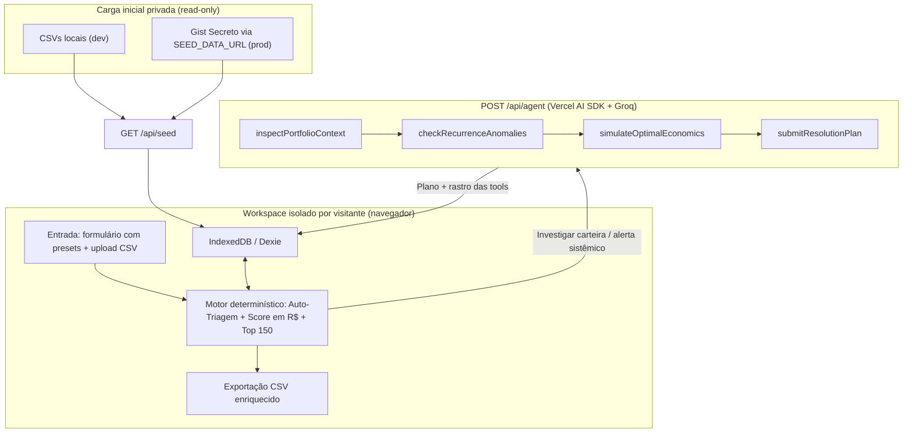

# 🚨 Opera Gogroup — Central AI-First de Exceções Operacionais

## 🧠 Visão Geral

Plataforma **IPA (Intelligent Process Automation)** construída para o **Problema 2 (Operações)** do Desafio AI-First da Gogroup.

Hoje, a fila de pedidos com exceção (atraso, extravio, falha de personalização, pagamento pendente, ruptura, endereço divergente) é tratada **por ordem de chegada**, com capacidade limitada a **150 tratativas/dia**. Este projeto transforma essa fila passiva em uma central orientada por **R$ em Risco**, respondendo às perguntas do desafio:

| Pergunta do desafio | Como a solução responde |
|---|---|
| Com a capacidade atual, quais pedidos tratar hoje e por quê? | Top 150 tratativas/dia ranqueadas por **R$ em Risco**, agrupadas por carteira de cliente |
| O que está causando as exceções? | **6 causas-raiz** detectadas nos dados, com custo acumulado e concentração |
| Quais problemas se resolvem caso a caso e quais exigem mudar o processo? | Casos individuais vão para a fila; causas sistêmicas viram **Ordens de Contenção** |
| Quanto dinheiro está em risco e quanto a solução recupera? | KPIs ao vivo: **R$ em exposição** vs. **R$ protegido/recuperado** |

### Resultados nos dados do desafio

| Indicador | Resultado |
|---|---|
| Pedidos com exceção analisados | **2.042** (R$ 224.118,64 em exposição) |
| Casos resolvidos sem fila humana (Auto-Triagem) | **456** (241 + 142 + 73) |
| Pedidos destravados no Dia 1 com 150 tratativas | **~384** (vs. **118** na ordem de chegada / FIFO) |
| Pedidos onde reenviar custa mais que reembolsar | **61** |
| R$ protegido/recuperado | _preencher com o valor exibido no KPI da aplicação_ |

---

## 🏗️ Arquitetura do Projeto



**Princípio central:** toda aritmética e regra de negócio é **código determinístico testado** (TypeScript + Vitest). O LLM **nunca calcula** — ele orquestra *tools*, interpreta contexto e monta o plano; os números vêm das funções puras.

---

## ⚙️ Stack Utilizada

* **Frontend / Backend:** Next.js (App Router) + TypeScript
* **Estilo:** Tailwind CSS + Lucide Icons
* **Agente de IA:** Vercel AI SDK (`ai`, `@ai-sdk/groq`) + validação estruturada com Zod
* **Modelo:** `openai/gpt-oss-20b` na Groq, com transbordo para `openai/gpt-oss-120b` e contingência determinística local
* **Banco no navegador:** IndexedDB via Dexie (`dexie`, `dexie-react-hooks`)
* **CSV:** PapaParse
* **Testes:** Vitest
* **Deploy:** Vercel + GitHub

---

## 📦 Camadas da Solução

### 🔹 Camada 1 — Dados e Segurança

* Os dados do desafio são confidenciais: **nenhum `.csv`, `.env` ou `.local-seed.json` é versionado** (`.gitignore`)
* `npm run generate:seed` converte os CSVs em um único `.local-seed.json` local
* Em produção, o backend lê o seed de um **Gist Secreto** (`SEED_DATA_URL`), sem expor a URL ao cliente
* Em desenvolvimento, `GET /api/seed` lê os CSVs locais automaticamente

### 🔹 Camada 2 — Motor Determinístico (`src/lib/`)

* `business-rules.ts`: calendário útil, Auto-Triagem e *unit economics*
* `priority-engine.ts`: agrupamento por carteira, score em R$ e comparativo vs. FIFO
* `anomalies.ts`: detector das 6 causas-raiz (recalcula se o avaliador importar novos pedidos)
* `types.ts`: tipagem do domínio

### 🔹 Camada 3 — Workspace por Visitante (`IndexedDB`)

Cada avaliador interage com **seu próprio banco no navegador**, sem login e sem afetar outros visitantes:

* `orders`, `customers`, `carriers`: dados de referência e pedidos (incluindo os inseridos manualmente)
* `containments`: ordens de contenção ativas
* `claims`: protocolos de ressarcimento contra transportadoras
* `auditLogs`: histórico reversível de ações automáticas e aprovadas

### 🔹 Camada 4 — Agente de IA (`POST /api/agent`)

Dois modos com o mesmo agente (detalhados abaixo).

### 🔹 Camada 5 — Interface

Três abas: **Fila Inteligente**, **Radar Sistêmico** e **Auditoria da Auto-Triagem**.

---

## 🔁 Fluxo End-to-End

1. Seed carregado no `IndexedDB` do visitante (`GET /api/seed`)
2. **Auto-Triagem** limpa os casos determinísticos (456 na base original)
3. Pedidos restantes são pontuados em **R$ em Risco** e agrupados por cliente
4. Top 150 tratativas do dia são exibidas (visão por carteira ou por pedido)
5. Operador aciona o **Agente** → recebe plano em R$ com rastro das *tools*
6. **Aprovação em 1 clique** → KPIs, auditoria e eventuais sinistros são atualizados ao vivo
7. Causas-raiz geram **Ordens de Contenção** que passam a reger as próximas decisões da fila

---

## 🧠 Principais Decisões Lógicas/Arquiteturais

### 📌 1. Auto-Triagem determinística e auditável (Zero Fila Humana)

Três regras **sem sobreposição** eliminam casos que não deveriam consumir tempo humano. Todas são reversíveis em 1 clique para a fila humana.

| Regra | Casos | Critério | Ação automática |
|---|---|---|---|
| **A** `auto_encerrado_entregue` | 241 | Atraso com `data_entrega` já preenchida | Encerra o chamado |
| **B** `auto_cobranca_pix` | 142 | `pagamento_pendente` (inclui 32 travados em `aguardando_transportadora`) | Link Pix 24h; expiração libera estoque |
| **C** `auto_aviso_falso_atraso` | 73 | Atraso sem entrega, mas dentro do prazo real contratado | Aviso proativo com a data real |

### 📌 2. Correção do prazo contratado (bug de dias corridos)

Parte dos chamados de atraso nasce de um cálculo legado em **dias corridos**. O prazo real é:

`1 dia útil de separação + sla_contratado_dias_uteis`, pulando sábados, domingos e feriados nacionais (`07/09/2026` e `12/10/2026`).

### 📌 3. Priorização em Reais (score por carteira)

```
R$ em Risco = Risco Direto do Pedido
            + Urgência Marginal de Mudança de Faixa (Cliff SLA)
            + LTV 12m em Risco (1x por cliente)
            + Economia de Contatos SAC
```

* **Risco direto:** `valor × probCancelamento(diasUteisAtraso)` (0%, 4%, 10%, 22%, 40%); para exceções concretizadas (extravio, avaria, vazamento etc.), pondera custo de perda/reembolso por severidade e dias em aberto
* **Cliff SLA:** soma o salto de perda (`deltaProb × valor`) quando o pedido está no último dia antes de mudar de faixa (2→3, 5→6, 10→11)
* **LTV em risco:** `ticket médio × queda de recompra` (35% se VIP com receita > R$ 1.500; 14% nos demais), contado **uma única vez por cliente**
* **SAC:** R$ 9,00 de contato evitado por pedido extra agrupado

### 📌 4. Matriz de ação economicamente ótima

| Situação | Decisão |
|---|---|
| Reenvio seguro | `24% CMV + frete` da transportadora recomendada |
| Reexpedição de devolvido (ex.: personalizados Gocase) | `0% CMV + frete`, após confirmar endereço |
| Item faltante com brinde / ruptura pós-venda | Voucher ou crédito instantâneo (frete R$ 0) |
| Reenvio mais caro que reembolso (61 pedidos) | Reembolso/voucher; **mantém reenvio para VIP** se o LTV salvo superar a diferença |

### 📌 5. Trava Tripla de Consolidação Física

Só consolida reenvios na mesma caixa se **mesmo CD + mesma UF/cidade + ≥ 2 reenvios físicos**. Caso contrário, mantém expedições independentes.

### 📌 6. Agente com *tool calling* e dupla atuação

**Modo `portfolio_resolution` (fila Top 150)** — 4 *tools* determinísticas:

1. `inspectPortfolioContext`: detalha pedidos, perfil VIP/LTV e checa a trava tripla
2. `checkRecurrenceAnomalies`: cruza os pedidos com as armadilhas operacionais e contenções ativas
3. `simulateOptimalEconomics`: compara o custo líquido em R$ de cada opção e a elegibilidade de ressarcimento
4. `submitResolutionPlan`: entrega o plano validado por Zod (ação, alternativa de override, rota/máquina/lote substituto, sinistro, economia líquida, justificativa e mensagem única ao cliente)

**Modo `systemic_containment` (Radar Sistêmico)** — investiga uma causa-raiz, quantifica a exposição recorrente e emite uma **Ordem de Contenção Operacional** (regra de bloqueio/redirecionamento que passa a valer no sistema + comunicado técnico para CD/Logística/TI).

A resposta inclui o **plano estruturado** e o array **`toolTraces`**, exibidos na interface para total transparência.

### 📌 7. Resiliência do agente

Cadeia de contingência: `gpt-oss-20b` → `gpt-oss-120b` (transbordo por rate-limit) → **contingência determinística local**. A aplicação continua funcional mesmo sem LLM disponível.

### 📌 8. Causas-raiz e travas anti-reincidência

| Causa-raiz | Contenção |
|---|---|
| Bug de dias corridos no checkout | Prazo real calculado em dias úteis + aviso proativo |
| Máquina `IMP-02` (falha de personalização) | Bloqueia a máquina; reimpressão em `IMP-01`/`IMP-03` (CD1) |
| Lote `L2607-B` (vazamento, `APC-1067`) | Proíbe expedir do lote; exige lote íntegro ou voucher/reembolso |
| `Rota Express` no Nordeste (CE, PB, PE, BA, RN) | Redireciona para `Veloz Log` (+R$ 3,22, mesmo SLA de 6 dias úteis, eliminando os 64% de atraso) |
| `Carga Norte` + vidro `Lescent` (avarias) | Embalagem reforçada, troca de transportadora e **protocolo de ressarcimento** |
| CD2 Noite + brinde / ruptura `Kokeshi` | Voucher em vez de reenvio físico de brinde; tratamento da ruptura |

### 📌 9. Privacidade dos dados no GitHub público

Repositório público contendo **apenas o código**. Dados e chaves ficam fora do Git (`.gitignore`), e o seed em produção é servido por Gist Secreto via variável de ambiente.

---

## 🖥️ Interface

Design limpo e denso, focado em ler números em R$ e agir em 1 clique.

* **Barra de KPIs fixa:** R$ em exposição vs. protegido, capacidade diária (`X / 150`), multiplicador vs. FIFO, casos auto-triados e ressarcimentos a receber
* **Aba 1 — Fila Inteligente:** busca textual (pedido, cliente, SKU, cidade), filtros combináveis (Top 150 / fila completa, marca, tipo de exceção, CD, transportadora, VIP, multi-pedidos, status), alternância **Visão por Carteira / por Pedido** e painel do agente com botão **"Aprovar e Executar Plano"**
* **Aba 2 — Radar Sistêmico:** comparativo **FIFO vs. Central AI-First** e cards das 6 causas-raiz com ativação de Ordens de Contenção em 1 clique
* **Aba 3 — Auditoria da Auto-Triagem:** lista dos 456 casos por regra com **"Reverter para Fila Humana"**, protocolos de ressarcimento e log de ações
* **Ingestão:** formulário com 4 *presets* de teste (atraso já entregue, VIP com vazamento do lote L2607-B, capinha Gocase na IMP-02, extravio no Nordeste via Rota Express) e upload de `.csv`
* **Exportação:** `.csv` respeitando busca/filtros, enriquecido com `prazo_real_dias_uteis`, `risco_financeiro_brl`, `vip`, `acao_executada` e `economia_gerada_brl`
* **Reset:** restaura a simulação ao estado inicial

---

## 🧪 Qualidade e Testes

Suíte **Vitest** cobrindo o motor matemático:

* Cálculo de dias úteis com fins de semana e feriados
* Partição sem sobreposição da Auto-Triagem (`241 + 142 + 73 = 456`)
* Economia unitária: identificação dos 61 pedidos onde reenvio > reembolso, proteção VIP, CMV zero em reexpedição Gocase e trava tripla de consolidação
* Importação e exportação de CSV preservando filtros
* Build de produção com checagem de tipos e testes de integração em `/api/seed` e `/api/agent`

---

## 🐳 Como Rodar Localmente

```bash
git clone https://github.com/<seu-usuario>/opera-gogroup.git
cd opera-gogroup
npm install
cp .env.example .env   # preencha GROQ_KEY_API
npm run test           # suíte Vitest
npm run dev            # http://localhost:3000
```

> Em desenvolvimento, os CSVs do desafio devem estar na pasta `../dados-csv/case_operacoes/`.

## 🚀 Deploy (GitHub Público + Vercel)

1. Gere o seed local (ignorado pelo Git):
   ```bash
   npm run generate:seed
   ```
2. Crie um **GitHub Gist Secreto** com o conteúdo de `.local-seed.json` e copie a URL **Raw**
3. Na **Vercel**, configure as variáveis de ambiente:
   * `GROQ_KEY_API`: sua chave da Groq
   * `SEED_DATA_URL`: URL Raw do Gist Secreto
4. Confira `git status` antes do push: nenhum dado sensível deve aparecer

---

## 📁 Estrutura do Projeto

```
opera-gogroup/
├── scripts/
│   └── generate-seed.mjs
├── src/
│   ├── app/
│   │   └── api/
│   │       ├── agent/route.ts      # Agente Groq com tool calling
│   │       └── seed/route.ts       # Carga inicial privada
│   ├── components/                 # KpiHeader, SmartQueueTab, AgentActionPanel,
│   │                               # SystemicRadarTab, AutoTriageAuditTab, IngestModal
│   └── lib/
│       ├── business-rules.ts       # Calendário útil, Auto-Triagem, unit economics
│       ├── priority-engine.ts      # Score em R$ e comparativo vs. FIFO
│       ├── anomalies.ts            # Detector das causas-raiz
│       ├── csv-io.ts               # Importação/exportação CSV
│       ├── db.ts                   # Dexie (IndexedDB)
│       └── types.ts
├── .env.example
├── .gitignore
└── README.md
```

---

## 🚀 Diferenciais Implementados

✔ Agente de IA com *tool calling* e saída estruturada validada (Zod)
✔ Toda a aritmética em código determinístico testado, sem "chute" do LLM
✔ Auto-Triagem sem fila humana, auditável e reversível em 1 clique
✔ Priorização por R$ em Risco com visão de carteira do cliente
✔ Ordens de Contenção Sistêmica que alteram as decisões futuras da fila
✔ Transparência total: rastro das *tools* visível na interface
✔ Contingência em 3 níveis para o agente (20b → 120b → determinístico local)
✔ Workspace isolado por visitante, sem login
✔ Dados confidenciais protegidos fora do repositório público

---

## 📌 Possíveis Evoluções

* Integração real com ERP/WMS para executar as ações (Pix, voucher, reexpedição) em vez de simulá-las
* Persistência compartilhada no servidor para operação multiusuário
* Monitoramento de reincidência das contenções (antes vs. depois)
* Ajuste automático das probabilidades de cancelamento com dados reais
* CI/CD com GitHub Actions rodando os testes a cada push

---

## 👨‍💻 Autor

Projeto desenvolvido como parte do **Processo Seletivo Gogroup — Etapa 3 (Desafio AI-First)**, com foco em transformar IA em capacidade de execução para a operação.